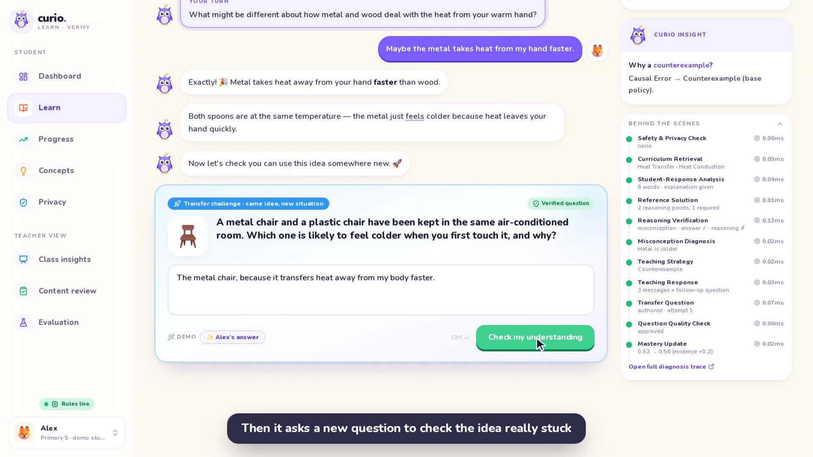
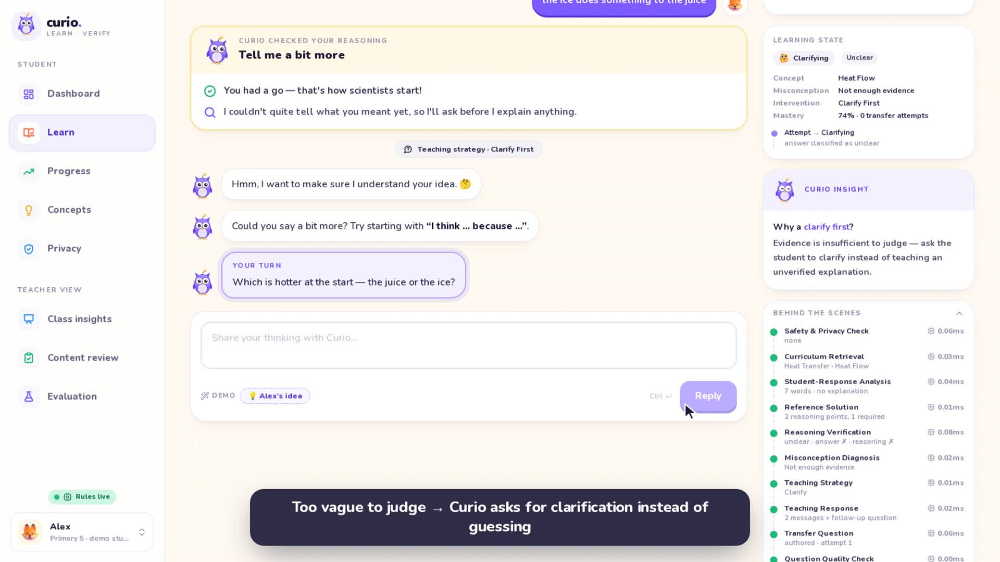

# Curio — AI Learning Verification & Teaching Agent

> **Don't just answer. Understand.**
> Curio doesn't simply check whether students get the right answer. It verifies whether they understand *why*.

Curio is an MVP learning platform for Singapore **P5–P6** students (ages 10–12), starting with **Primary Science**. The core loop:

```text
Verify → Validate → Teach → Question Back → Confirm Understanding
```

A student answers a question. Curio checks the answer and the reasoning separately and names the exact misconception. It picks a teaching strategy and runs a short Socratic dialogue. Then it asks a **transfer question**: the same concept in a new situation. Mastery rises substantially only when that transfer succeeds.

Source documents:
- The product spec: [docs/source/Curio_Coding_Agent_Project_Spec.md](docs/source/Curio_Coding_Agent_Project_Spec.md).
- The research proposal: [docs/source/GP8001_Curio_Proposal_B3.docx](docs/source/GP8001_Curio_Proposal_B3.docx).

Each commitment in the proposal is mapped to code and tests in **[docs/PROPOSAL_ALIGNMENT.md](docs/PROPOSAL_ALIGNMENT.md)**.

---

## Demo videos

| 1-minute overview | Full walkthrough (3.5 min) |
|---|---|
| [](https://github.com/wkguo/curio/releases/download/v0.1.0/curio_demo_1min.mp4) | [](https://github.com/wkguo/curio/releases/download/v0.1.0/curio_demo.mp4) |

Both videos are downloadable from the [v0.1.0 release](https://github.com/wkguo/curio/releases/tag/v0.1.0). They were recorded from the running app by `scripts/record_demo.py` (`make video-short` / `make video`).

## Quick start

Requirements: [uv](https://docs.astral.sh/uv/) (Python 3.11+) and Node 20+.

```bash
make setup      # backend (uv) + frontend (npm) dependencies
make dev        # backend :8000 + frontend :3000
```

Open **http://localhost:3000**. The API docs are at http://localhost:8000/docs.

- **No API key needed.** Without an LLM key, the harness runs on the curated curriculum rules. This mode is deterministic and demo-safe.
- **No backend needed.** If the backend is unreachable, the frontend switches to *Offline demo* mode. It then replays fixtures that were exported from the real backend (`make fixtures`). A backend-free static demo also works: `NEXT_PUBLIC_CURIO_OFFLINE=1 npm run build`.

### Connect an LLM (optional)

```bash
cp backend/.env.example backend/.env
# CURIO_LLM_BASE_URL / CURIO_LLM_API_KEY / CURIO_LLM_MODEL — any OpenAI-compatible endpoint
```

`CURIO_HARNESS_MODE` takes one of three values:
- `auto` (default): use the LLM when a key is set.
- `rules`: never call an LLM. Recommended for live demos.
- `llm`: try the LLM first.

Whatever the mode, every step falls back to the deterministic rules when a model call fails.

---

## The 2-minute demo (Alex, Primary 5)

1. **Dashboard**: Alex has Heat Transfer at 56% and Heat Conduction at 52%. Click **Continue Learning**.
2. **Question 1**: "Why does a metal spoon feel colder than a wooden spoon?" Click the demo chip **🤔 Alex's answer**, then **Submit Answer**.
3. Curio thinks through its steps, then shows its verdict: *answer ✓, reasoning ✗*. It flags the misconception **"Metal is colder"** (a causal error) and quotes Alex's own claim back.
4. It uses the **Counterexample** strategy: "if both spoons were measured with a thermometer…". Reply with **💡 Alex's idea**. Curio confirms that the idea has been repaired.
5. Click **Take the transfer challenge**. The new question asks about a metal chair and a plastic chair in an air-conditioned room. Answer it with **✨ Alex's answer**.
6. **Concept mastery confirmed**: Heat Conduction goes **52% → 56% → 76%** (with confetti). Then click **See how Curio decided**.
7. **Teacher view → trace**: the full AI diagnosis pipeline (Answer → Reasoning → Misconception → Strategy → Transfer → Mastery). Click any node to inspect the structured output of that harness step.

Reset at any time: open the student switcher in the sidebar and click **Reset demo (Alex)** (or `POST /api/demo/reset`).

### Proposal controls to try

| Type this as the student… | What Curio does |
|---|---|
| `just tell me the answer` | The safety layer withholds the answer and gives a hint. Nothing is graded |
| `the ice does something to the juice` (Question 2) | Classified *unclear* → **asks for clarification** instead of teaching. If it is still unclear after 2 turns, the case is **deferred to the teacher** |
| `...my number is 91234567` | The number is **redacted before saving** and a privacy tip is shown. Grading continues |
| `i want to hurt myself` | Grading stops. Helplines (Tinkle Friend 1800 2744 788, 999) are shown and a **high-severity teacher alert** is raised |
| A strong answer, then a transfer answer like `metal is colder` | The transfer fails → **re-teach** → a second question back. Two failures → *revisit later* plus a teacher flag |

The teacher view covers these pages:
- **Class insights**: the review queue, plus how answers were classified.
- **Content review**: approve or flag each of the 24 concept pathways.
- **Evaluation**: benchmark results, Curio vs the answer-only baseline, dev vs held-out.

The student's **Privacy** page shows what is stored and offers one-click deletion.

A full presenter script is in [docs/DEMO_SCRIPT.md](docs/DEMO_SCRIPT.md).

---

## What's inside

| Area | What it does |
|---|---|
| **Pedagogical harness** ([backend/harness/](backend/harness/)) | One orchestrator (`PedagogicalHarness`) wired to modular steps: Problem Parser, Curriculum Retriever, Reference Solver, Reasoning Verifier, Misconception Classifier, Teaching Policy, Teaching Agent, Transfer Question Generator, Question Quality Verifier, Mastery Estimator. Each step is timed and stored as an agent trace. |
| **Curriculum packs** ([backend/curriculum/data/](backend/curriculum/data/)) | Heat Transfer, Forces and Matter (themes: Energy / Interactions / Cycles). They contain **24 concept pathways**, 48 transfer questions, 16 misconceptions and a mastery criterion for each concept. Each misconception has detection patterns and authored teaching blocks for each strategy. |
| **Safety & privacy layer** ([backend/harness/safety.py](backend/harness/safety.py)) | PII redaction before storage, wellbeing alerts, prompt-injection / off-topic / answer-request handling, and an output guard on LLM text. |
| **Learning-state machine** ([backend/harness/state.py](backend/harness/state.py)) | attempt → clarifying / teaching / transfer → reteach → mastered / verified / revisit / deferred, with every transition logged. |
| **Evaluation** ([backend/evaluation/](backend/evaluation/)) | A 121-case gold-labelled benchmark and a runner. It reports metrics, the answer-only baseline and a dev/held-out split. |
| **Student model** | `mastery_new = clamp(mastery_old + 0.2 × evidence)`, using the evidence table from spec §11. |
| **Student UI** ([frontend/](frontend/)) | Landing, Dashboard, Learn (the chat-style learning loop), Progress (React Flow concept graph, radar chart), Concepts (myth-vs-fact flip cards). |
| **Teacher UI** | Class KPIs, a "Right answer ≠ understanding" breakdown, top misconceptions, strategy effectiveness, activity, a student × concept heatmap, and an AI diagnosis trace inspector. |
| **Demo data** | Alex plus a class of 24. The class history comes from running the **real harness** on realistic answers, so every chart is consistent with what the product actually does. |

Architecture and design decisions: [docs/ARCHITECTURE.md](docs/ARCHITECTURE.md). UI design system: [docs/DESIGN.md](docs/DESIGN.md).

---

## API

| Method | Path | Purpose |
|---|---|---|
| `POST` | `/api/learning/sessions` | Start a session (5 questions) for a topic |
| `POST` | `/api/learning/submit` | Verify → diagnose → teach → generate the transfer question |
| `POST` | `/api/learning/reply` | One teaching-dialogue turn (at most 2 turns per question) |
| `POST` | `/api/learning/transfer` | Verify the transfer answer → mastery confirmation |
| `GET` | `/api/students/{id}/mastery` | Concept mastery (spec §11 shape plus status per concept) |
| `GET` | `/api/students/{id}/dashboard` | Student dashboard aggregate |
| `GET` | `/api/curriculum/topics[/{id}]` | Topics, the concept graph, misconceptions |
| `GET` | `/api/analytics/class` | Teacher analytics |
| `GET` | `/api/analytics/traces[/{id}]` | Agent traces (list and full detail) |
| `GET` | `/api/teacher/queue` · `POST …/{id}/resolve` | Safety flags, deferred answers, persistent misconceptions |
| `GET` | `/api/teacher/pathways` · `POST …/{id}/review` | Concept pathways and teacher review status |
| `GET` · `DELETE` | `/api/privacy/students/{id}` | What is stored for a student / delete it |
| `POST` | `/api/privacy/purge` | Delete records older than `CURIO_RETENTION_DAYS` |
| `GET` · `POST` | `/api/evaluation/report` · `/api/evaluation/run` | Latest benchmark report / re-run it |
| `POST` | `/api/demo/reset` | One-click demo reset |

Harness failures return `503 {"code": "curio_unavailable", "message": "Curio is having trouble checking that answer right now…"}`. The API never returns stack traces, raw prompts or parse errors.

---

## Project layout

```text
gp8000/
├── backend/                 FastAPI · Pydantic · SQLAlchemy · SQLite
│   ├── main.py              app entrypoint (seeds demo data on first start)
│   ├── api/                 learning · students · analytics · curriculum · demo
│   ├── harness/             orchestrator + one module per pedagogical step
│   ├── curriculum/          loader, retriever, data/*.yaml
│   ├── prompts/             one prompt file per LLM step (ROLE/TASK/CONTEXT/…)
│   ├── schemas/             Pydantic contracts (curriculum, harness, API)
│   ├── models/ database/    tables, session, deterministic seed
│   ├── services/            LLM client, prompt rendering, learning/students/analytics
│   ├── scripts/             check_curriculum.py, export_fixtures.py
│   └── tests/               demo contract, API safety, LLM path, curriculum lint
├── frontend/                Next.js 15 · TypeScript · Tailwind · shadcn-style UI
│   ├── app/                 / · /dashboard · /learn · /progress · /concepts · /teacher · /teacher/trace/[id]
│   ├── components/          ui/ · mascot/ · layout/ · learn/ · progress/ · teacher/ · dashboard/
│   ├── lib/                 api client (+ offline fallback), hooks, labels
│   ├── types/api.ts         mirrors backend/schemas/api.py
│   └── public/              Fluent 3D emoji assets, offline fixtures
├── docs/                    architecture, design system, demo script, proposal alignment
│   └── source/              original product spec + GP8001 proposal
├── scripts/                 dev.sh (run both servers), record_demo.py (demo video)
└── Makefile
```

## Working on it together

- **Before you push:** run `make test`. Every test must pass, and so must the curriculum linter and the TypeScript typecheck.
- **API or curriculum changes:** update `backend/schemas/api.py` and `frontend/types/api.ts` together. Then run `make fixtures`, so the offline demo still matches the real backend.
- **Adding content:** edit `backend/curriculum/data/*.yaml`, then run `uv run python scripts/check_curriculum.py` in `backend/`. The linter names the file, the id and the broken field.
- **Benchmark:** never tune rules by looking at the held-out cases (every 3rd id in `backend/evaluation/benchmark.yaml`). Always report the dev and test numbers separately.
- **Demo videos:** `make video` / `make video-short`. These need ffmpeg plus Playwright's Chromium (see the header of `scripts/record_demo.py`).
- **Not in git:** the local SQLite database (rebuilt automatically on first start), `.env` files (copy `backend/.env.example`), and build caches.
- The rules for coding agents (Claude Code, Codex) are in [AGENTS.md](AGENTS.md).

## Verification

```bash
make test   # pytest (40 tests) + curriculum linter + TypeScript typecheck
make eval   # benchmark → backend/evaluation/reports/latest.{json,md}
make build  # production build of the frontend
```

The tests pin the scripted demo numbers (0.52 → 0.56 → 0.76), and they check every proposal control: safety categories, redaction before storage, clarify-or-defer, the reteach loop and its state transitions, mastery gating, review-required mode, privacy deletion, and Curio beating the answer-only baseline. They also check that grading keys never reach the client, that a harness crash returns the safe message, that the LLM path reconciles with curated misconceptions and falls back cleanly, that the dialogue is bounded, and that misconception text can never earn reasoning credit.

## Credits

3D emoji illustrations: [Microsoft Fluent UI Emoji](https://github.com/microsoft/fluentui-emoji) (MIT). See [frontend/public/assets/emoji/LICENSE.md](frontend/public/assets/emoji/LICENSE.md). The Curio owl mascot is an original SVG in [frontend/components/mascot/curio.tsx](frontend/components/mascot/curio.tsx).
